<p align="center">
  <picture>
    <source media="(prefers-color-scheme: dark)" srcset="docs/hero-dark.png">
    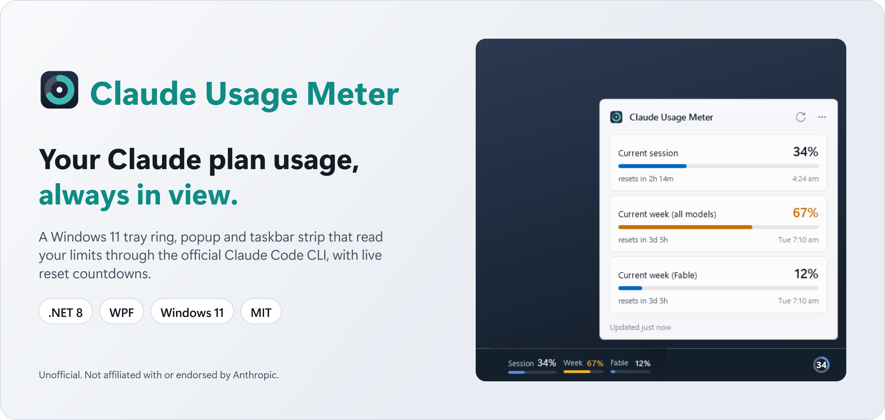
  </picture>
</p>

<p align="center">
  <a href="https://github.com/MrSinux/ClaudeUsageMeter/actions/workflows/ci.yml"></a>
  <a href="LICENSE"></a>
  <a href="https://github.com/MrSinux/ClaudeUsageMeter/releases/latest"></a>
  
  
</p>

**Claude Usage Meter** shows your Claude plan usage on the Windows 11 desktop, so you never have to open the usage page.\
A ring in the notification area, a popup with every usage block and a live reset countdown, and an optional strip on the taskbar.\
It reads the numbers only through the official Claude Code CLI (`claude /usage`). It never touches your sign-in tokens, never calls Anthropic's servers itself, and a check costs no usage.\
Built with .NET 8 and WPF. One self-contained exe, about 44 MB of RAM, near-zero CPU between refreshes.

> [!NOTE]
> **Unofficial.** Claude Usage Meter is an independent open-source project. It is not affiliated with, endorsed by or supported by Anthropic. Claude and Claude Code are trademarks of Anthropic, PBC, and are used here only to describe what the app works with.

## How it works

1. Every 2 minutes (1 to 15 in Settings), when you open the popup (at most every 30 s), and after the PC wakes from sleep, the meter runs one command as a hidden child process:

   ```text
   claude -p /usage --output-format text --no-session-persistence --safe-mode
   ```

2. `/usage` is a local Claude Code command. It prints your plan's usage panel and **does not start a model turn**, so it uses none of the usage it measures. (Checked with the JSON output: 0 turns, 0 tokens, $0.)
3. The meter parses every `<label>: <n>% used · resets <when>` line it finds. Blocks are read generically, so a renamed or new block (for example a different model's weekly limit) shows up without an update.
4. Each block becomes a bar with its % used, a colour (calm under 60%, amber from 60 to 85%, red above 85%) and a live countdown to its reset.
5. The tray ring shows the session % (or the first block when there is no session block). The strip and the popup show every block.
6. Optional Windows notifications fire at 80% and 95%, once per block per reset.
7. If a read fails, the meter says so honestly: it keeps the last good numbers **dimmed** for up to 10 minutes, then shows `--` with a short reason. It never shows a made-up number.

## Download and install

Requires **Windows 11** (Windows 10 1903 or later works, without the acrylic effect) and **[Claude Code](https://docs.claude.com/en/docs/claude-code) installed and signed in** with a Claude subscription.

1. Open the [latest release](https://github.com/MrSinux/ClaudeUsageMeter/releases/latest) and download **`ClaudeUsageMeter.exe`** (self-contained, no .NET needed). If you already have the [.NET 8 Desktop Runtime](https://dotnet.microsoft.com/download/dotnet/8.0), the much smaller `ClaudeUsageMeter-framework-dependent.zip` does the same job.
2. Put it anywhere you like, for example `%LOCALAPPDATA%\Programs\ClaudeUsageMeter\`, and run it. There is no installer.
3. **Windows SmartScreen will probably warn you**, because the exe is not code-signed: "Windows protected your PC". Choose **More info**, then **Run anyway**. Only do this if you downloaded it from this repository's Releases page. You can check the download against the SHA-256 listed in the release notes:

   ```powershell
   Get-FileHash .\ClaudeUsageMeter.exe -Algorithm SHA256
   ```

4. Windows 11 puts new tray icons in the overflow menu (^). To keep the ring visible, open **Settings > Personalization > Taskbar > Other system tray icons** and turn on **Claude Usage Meter**, or drag the icon onto the taskbar.
5. Optional: right-click the ring or the strip and choose **Start with Windows**. This adds a per-user entry (`HKCU\...\Run`), so no admin rights are needed. If you later move the exe or replace it with a newer copy somewhere else, the entry follows it the next time you start it.

The meter finds the CLI by itself: on your `PATH`, in the usual install folders (`~\.local\bin`, npm, pnpm, scoop) or bundled inside the Claude Code extension for VS Code, Cursor or Windsurf. You can also set the path in Settings.

**Uninstall:** turn off Start with Windows, choose **Quit**, delete the exe, and optionally delete `%APPDATA%\ClaudeUsageMeter` (settings) and `%LOCALAPPDATA%\ClaudeUsageMeter` (an empty working folder for the CLI).

## See it in motion

<p align="center">
  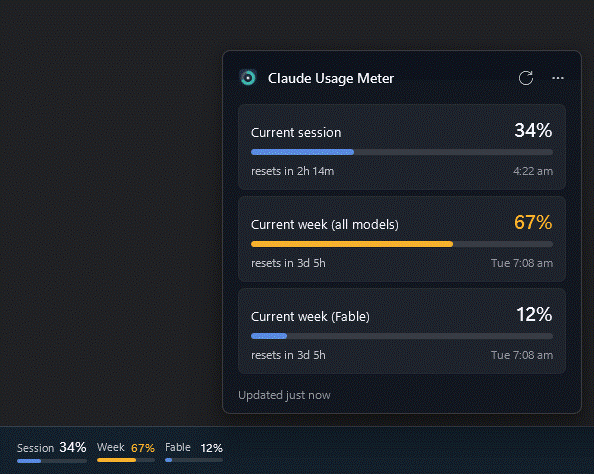
</p>

The GIF was recorded from the real app running in its demo mode (`--demo-cycle`), which feeds made-up readings every 4 seconds instead of running the CLI. It shows the bars easing to new values, the colour changing as a limit gets close, the **dimmed fallback** when a read comes back incomplete, and the recovery on the next read.

## Screenshots

| | |
| --- | --- |
| 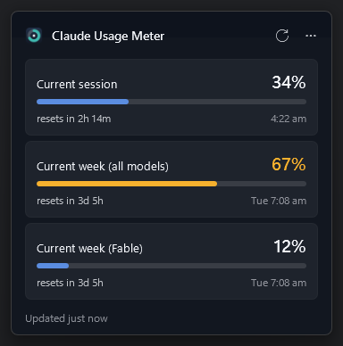 | 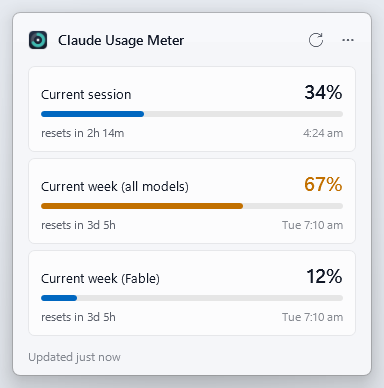 |
| **Popup, dark**: every block, countdowns, last updated | **Popup, light**: follows the Windows app theme |
| 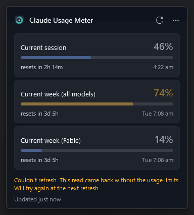 | 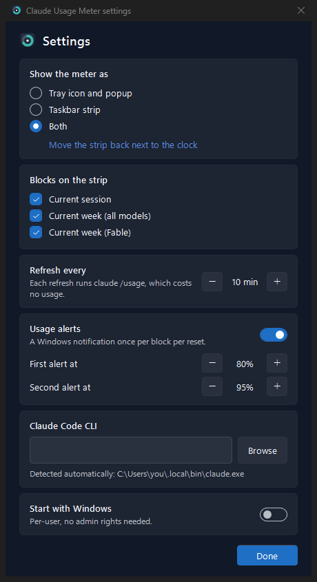 |
| **Dimmed fallback**: the last good numbers, clearly marked | **Settings**: applied as you change them |
| <br>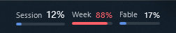 | 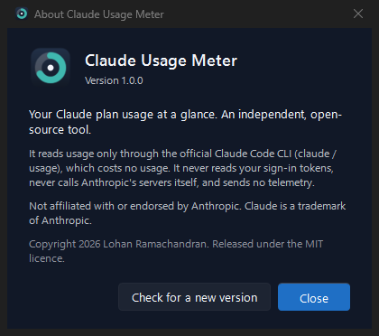 |
| **Taskbar strip**: calm, amber and red | **About**: version and the unofficial notice |

<p align="center">
  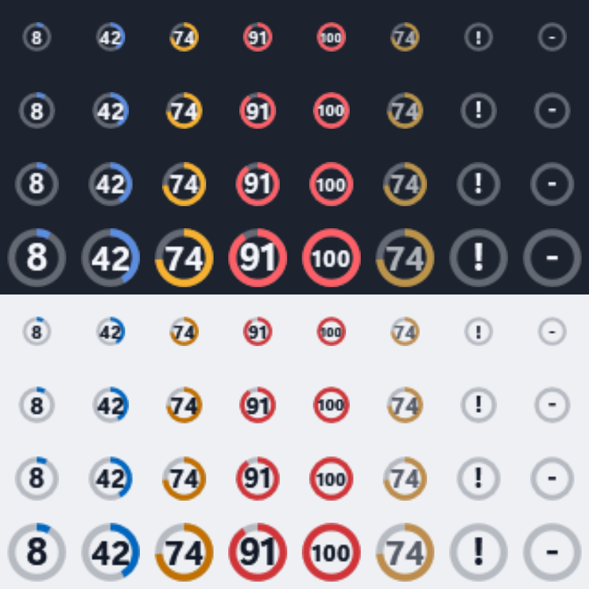
  <br><sub>The tray ring at real tray sizes, rendered by the app's own <code>TrayIconRenderer</code> (<code>--icon-sheet</code>).</sub>
</p>

All screenshots use the app's demo mode with made-up numbers.

## Features

**At a glance**
- Every usage block that `claude /usage` reports: the current session, the current week for all models, and per-model weekly limits.
- % used, a colour by level (calm, amber 60 to 85%, red above 85%) and a live countdown ("resets in 2h 14m") with the local reset time.
- "Updated just now" / "Updated 3m ago", and a refresh button.

**Three ways to show it**
- **Tray ring** with the session % drawn inside, sharp at every DPI, light and dark taskbar aware.
- **Popup** in the corner by the clock, Windows 11 style: acrylic, rounded corners, a short slide-in, bars that ease to new values (and respect "Animation effects: off").
- **Taskbar strip** with compact bars on the empty part of the taskbar. Drag it along the taskbar and it remembers its spot per monitor. It stays above the taskbar, hides for full-screen apps, follows DPI changes and moves between monitors.
- Pick **Tray popup**, **Taskbar strip** or **Both** from the right-click menu.

**Honest states**
- Fresh numbers, dimmed numbers after a failed refresh (up to 10 minutes), or `--` with a reason: Claude Code not found, signed out, offline, or output it couldn't read.
- A **Sign in again** banner when the CLI warns that the sign-in is about to end, with a button that opens `claude auth login` using the CLI the meter found.

**Alerts**
- Windows notifications at two thresholds (80% and 95% by default), once per block per reset, remembered across restarts. Notifications follow Focus and Do Not Disturb.

**Light on the machine**
- About 44 MB of private memory and about 0.2% of one CPU core while idle (measured with the self-contained exe on Windows 11).
- Only one CLI run at a time, with a 45 s timeout and process-tree kill.

**Privacy**
- No telemetry, analytics or network calls of its own, and no auto-updater. "Check for a new version" only opens the Releases page.
- Never reads `~/.claude/.credentials.json` or any token, never calls Anthropic's API, console or OAuth endpoints, and never sends a message to a model.

## Tech stack

| Layer | Technology | Version |
| --- | --- | --- |
| Runtime | [.NET](https://dotnet.microsoft.com) (`net8.0-windows` app, `net8.0` core library) | 8.0, built with SDK 8.0.428 |
| UI | WPF (Windows Presentation Foundation), XAML, C# 12 | .NET 8 |
| Tray icon | Own `Shell_NotifyIcon` (v4) wrapper over P/Invoke, no WinForms | Windows API |
| Window effects | DWM: acrylic backdrop, rounded corners, caption colour (`DwmSetWindowAttribute`) | Windows 11 22H2+ |
| Taskbar strip | Topmost tool window, `SetWinEventHook` (foreground), AppBar notifications (`SHAppBarMessage`) | Windows API |
| Notifications | Tray balloon (`NIF_INFO`), shown by Windows 11 as a native toast | Windows API |
| Settings | `System.Text.Json` file in `%APPDATA%` | .NET 8 |
| Data source | [Claude Code](https://docs.claude.com/en/docs/claude-code) CLI, `claude -p /usage` | Tested with 2.1.319 to 2.1.322 |
| Tests | [xUnit](https://xunit.net), Microsoft.NET.Test.Sdk | 2.5.3, 17.8.0 |
| Packaging | `dotnet publish`: self-contained single file (win-x64), and framework-dependent | .NET 8 |
| CI | GitHub Actions on `windows-latest`: build and test | n/a |

## Architecture

The meter has no server and no network code of its own. Everything it knows comes from the text the Claude Code CLI prints.

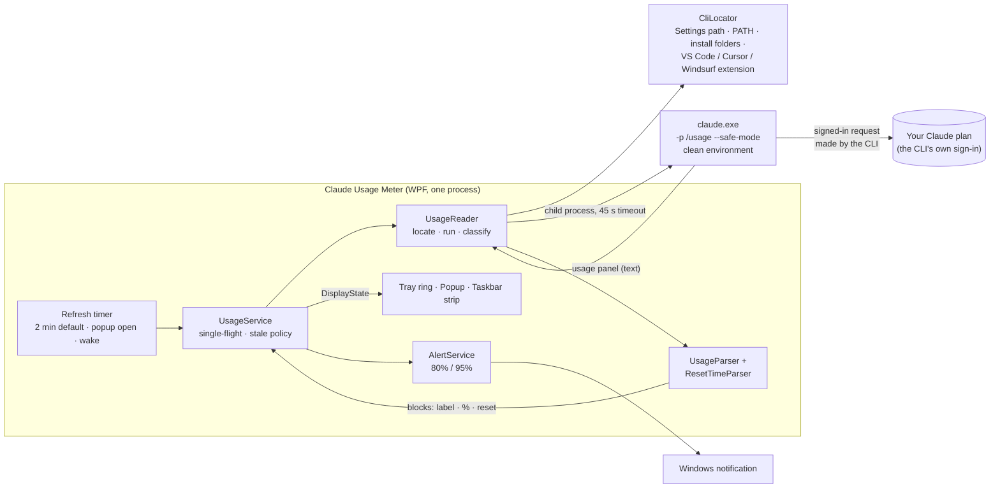

One refresh, including the quiet retry when the CLI prints its panel without the limit lines:

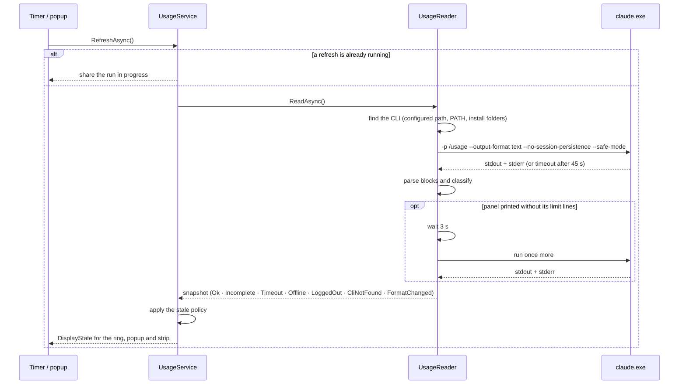

What you see after each read:

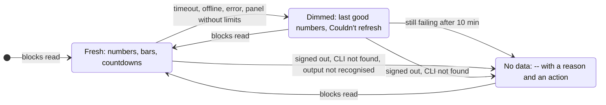

Signed out and CLI not found clear the numbers at once: the meter never shows numbers it can't vouch for.

**Keeping polls out of your Claude Code sessions.** A process started from inside a running Claude Code session (in VS Code, a terminal or Remote Control) inherits that session's identity and IPC handles through environment variables. The meter therefore starts the CLI with a clean environment: it drops every `CLAUDE*`, `ANTHROPIC_*`, `VSCODE_*`, `MCP_*`, `ELECTRON_*` and `TERM_PROGRAM*` variable unless you set it yourself in your Windows environment, so settings like `CLAUDE_CONFIG_DIR` still apply. It also adds `--safe-mode`, so a poll never runs your hooks, never connects your MCP servers or plugins, and doesn't load `CLAUDE.md`. A poll can't attach to, or disturb, a session that is mid-turn. [`IsolationTests`](tests/ClaudeUsageMeter.Tests/IsolationTests.cs) checks this with a stand-in `claude.cmd`.

## Configuration

Everything is in **Settings** (right-click the ring or the strip). Changes apply immediately and are saved to `%APPDATA%\ClaudeUsageMeter\settings.json`:

| Setting | Default | Notes |
| --- | --- | --- |
| Show the meter as | Both | Tray icon and popup, taskbar strip, or both. |
| Blocks on the strip | All | New blocks appear automatically. |
| Refresh every | 2 min | 1 to 15 minutes. Opening the popup also refreshes, at most every 30 s. |
| Usage alerts | On, 80% and 95% | Two thresholds, once per block per reset. |
| Claude Code CLI | Detected | Leave empty to detect automatically, or browse to `claude.exe` / `claude.cmd`. |
| Start with Windows | Off | Per-user Run entry, no admin rights. Follows the exe if you move or update it. |

Command-line switches, mainly for development and documentation:

| Switch | What it does |
| --- | --- |
| `--popup` | Open the popup as soon as the first read is in. |
| `--light`, `--dark` | Force the light or dark theme. |
| `--settings`, `--about` | Open that window at start. |
| `--demo` | Made-up numbers; the CLI is never run and no alerts fire. |
| `--demo-cycle` | Like `--demo`, with a new made-up reading every 4 s, including an incomplete one (used for the GIF). |
| `--test-alert` | Show a sample notification. |
| `--icon-sheet <file.png>` | Render every tray ring state to a PNG and exit. |
| `--ring-png <file.png> <size> <percent> <dark\|light>` | Render one tray ring and exit. |
| `--gpu` | Use hardware rendering (software rendering is the default because it saves about 30 MB). |

## Build from source

Requires Windows and the [.NET 8 SDK](https://dotnet.microsoft.com/download/dotnet/8.0).

```powershell
git clone https://github.com/MrSinux/ClaudeUsageMeter.git
cd ClaudeUsageMeter
dotnet test                                   # parser, reset times, alerts, CLI isolation (no real CLI needed)
dotnet run --project src/ClaudeUsageMeter -- --demo --popup

# Optional: one real /usage read through your own Claude Code (costs no usage)
$env:USAGE_METER_LIVE = "1"; dotnet test --filter LiveTests

# Release builds
dotnet publish src/ClaudeUsageMeter -c Release -r win-x64 --self-contained true `
  -p:PublishSingleFile=true -p:IncludeNativeLibrariesForSelfExtract=true -p:DebugType=none -o publish/self-contained
dotnet publish src/ClaudeUsageMeter -c Release -r win-x64 --self-contained false `
  -p:PublishSingleFile=true -p:DebugType=none -o publish/framework-dependent
```

Don't add `EnableCompressionInSingleFile`: the exe gets smaller, but every assembly is then unpacked into private memory (about 100 MB instead of 44 MB).

## Project structure

```text
.
├── ClaudeUsageMeter.sln
├── src/
│   ├── ClaudeUsageMeter.Core/         # net8.0, no UI
│   │   ├── CliLocator.cs              # Finds claude.exe: settings, PATH, install folders, editor extensions
│   │   ├── ClaudeCli.cs               # Runs the one /usage command (timeout, tree kill, --safe-mode fallback)
│   │   ├── ChildEnvironment.cs        # Clean environment for the child process
│   │   ├── UsageReader.cs             # Locate, run, retry once, classify into a snapshot
│   │   ├── UsageParser.cs             # Generic "<label>: <n>% used · resets <when>" parser
│   │   ├── ResetTimeParser.cs         # "Nov 12, 1am (Europe/Berlin)", "9pm", "in 2h 14m", IANA zones
│   │   ├── Countdown.cs               # "resets in 2h 14m"
│   │   ├── Alerts.cs                  # Once-per-block-per-reset thresholds
│   │   └── Models.cs                  # UsageBlock, UsageSnapshot, UsageStatus, levels
│   └── ClaudeUsageMeter/              # net8.0-windows, WPF
│       ├── App.xaml(.cs)              # Startup, single instance, tray, menu, alerts, switches
│       ├── Native/                    # Win32 P/Invoke, tray icon, DWM effects, taskbar geometry
│       ├── Services/                  # UsageService (polling, stale policy), settings, theme, startup, sign-in
│       ├── Rendering/                 # Tray ring renderer
│       ├── ViewModels/                # MeterViewModel
│       ├── Views/                     # Popup, taskbar strip, settings, about, animated bar
│       ├── Themes/                    # Light and dark colours, control styles
│       └── Assets/                    # App icon (the teal ring)
├── tests/ClaudeUsageMeter.Tests/      # xUnit; fixtures are made-up /usage output
├── tools/make-icon.ps1                # Renders the app icon
├── docs/                              # Hero, GIF, screenshots
├── .github/workflows/ci.yml           # Build and test on Windows
├── DECISIONS.md                       # Why it is built the way it is
└── LICENSE
```

## Limitations

- **It depends on the text of `claude /usage`.** The parser is generic, but if a future CLI prints usage in a very different shape, the meter shows "Couldn't read usage" with the first line the CLI printed, until it is updated.
- **Windows only**, and Windows 11 for the full look. The taskbar strip doesn't support vertical taskbars; the tray ring is used instead.
- **The strip belongs on empty taskbar space.** On recent Windows 11 builds the taskbar's own app buttons draw above every other window, so a strip dragged onto app buttons sits underneath them.
- **Taskbar auto-hide** is handled, but hasn't been verified on every Windows build.
- **New tray icons start in the overflow (^) menu**, a Windows rule an app can't change. See step 4 of the install.
- **Not code-signed**, so SmartScreen warns on first run.
- **Sign-in is Claude Code's.** If the CLI is signed out or its sign-in expires, the meter shows "Sign in again" and opens `claude auth login` for you; it can't sign in by itself.
- Notifications follow Windows Focus and Do Not Disturb: while those are on, alerts go quietly to the notification centre.

## Decisions

The main design choices and their trade-offs are written up in [DECISIONS.md](DECISIONS.md).

## Credits

Designed and built by **[Lohan Ramachandran](https://lohansinux.com)**.

Claude and Claude Code are trademarks of Anthropic, PBC. This project is not affiliated with or endorsed by Anthropic. The app icon (a teal progress ring) and all artwork here are original.

## License

[MIT](LICENSE) © 2026 Lohan Ramachandran
